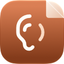
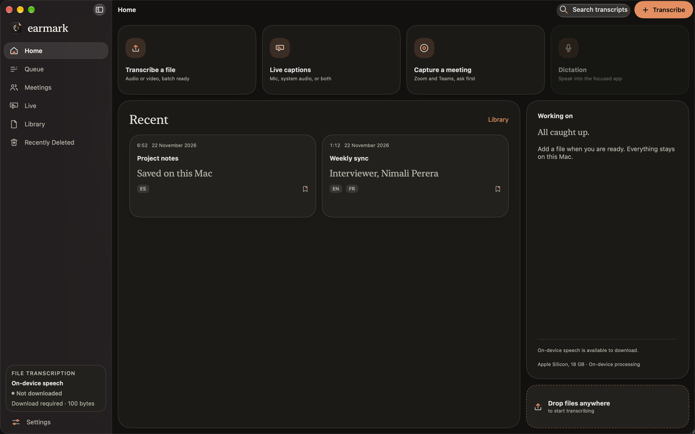
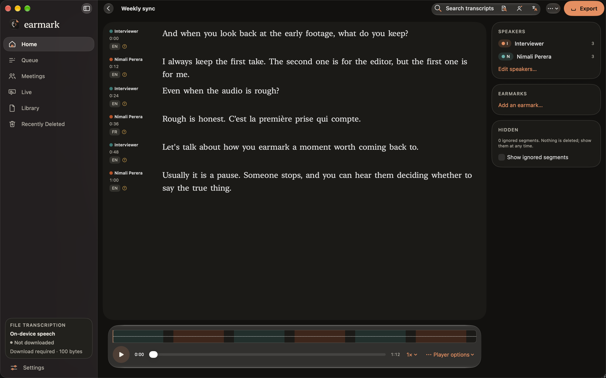
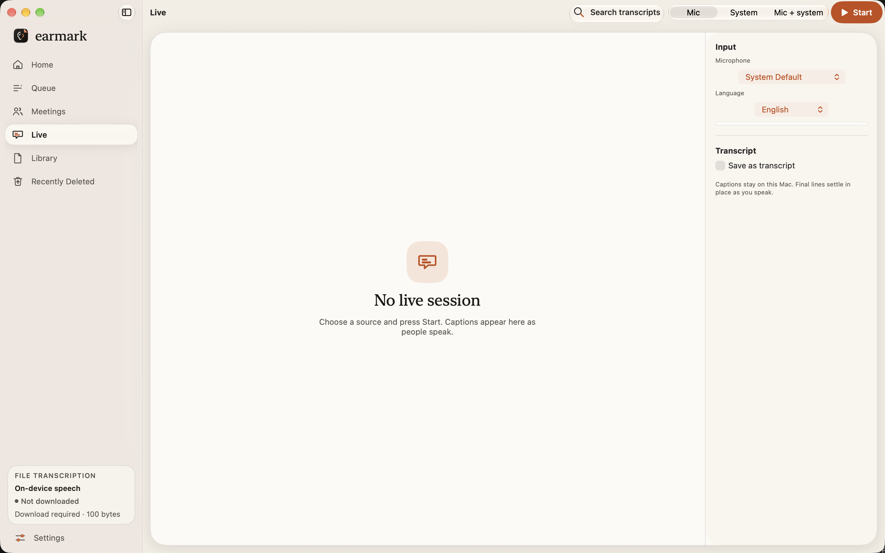
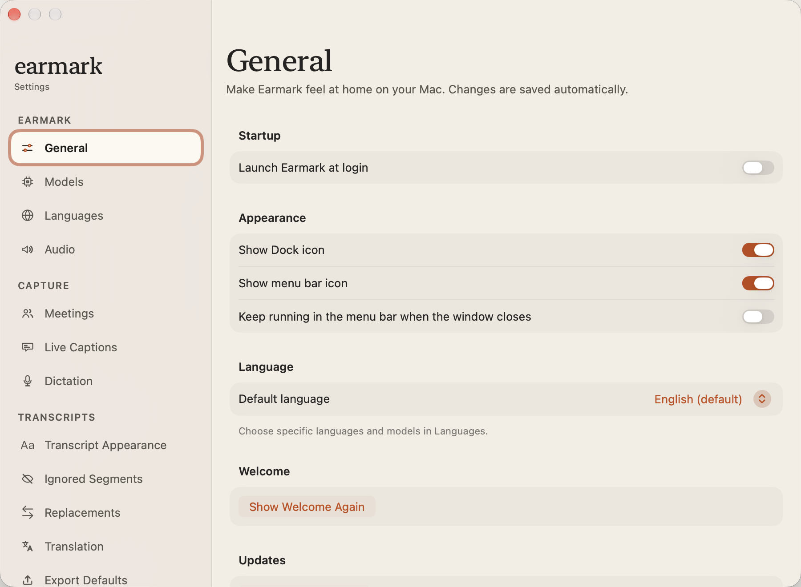

<div align="center">



# Earmark

### Listen once. Keep what matters.

Local transcription, live captions and an editor for the moments worth keeping.

**macOS 26+ · Apple silicon · On-device processing**

[Features](#features) · [Screenshots](#screenshots) · [Getting started](#getting-started) · [Build](#building-from-source)

</div>

Earmark turns audio and video into searchable, editable transcripts on your Mac. Transcribe a recording, follow a live conversation, capture a meeting or dictate into another app, then refine and export the result.

**Development preview:** Earmark is distributed without a paid Apple Developer account. Releases are signed with a self-signed certificate and are **not notarized**, so macOS asks you to approve the first launch (see [Getting started](#getting-started)). Remaining device acceptance checks are tracked in the [release checklist](specs/qa/release.md).

## Features

- **Files and batches.** Drop audio, video or folders into a persistent queue. A short Transcribe sheet lets you pick the language (one, several or auto-detect), the model and whether to identify speakers before anything starts. Pause, resume, reorder, retry or clear jobs while keeping saved transcripts.
- **Meeting capture.** Detect Zoom and Teams calls with an ask-first default, separate microphone and system-audio tracks, optional video and recording recovery. A diagnostics list in Settings shows exactly what the detector sees.
- **Live captions and dictation.** Caption microphone audio, system audio or both in a floating overlay you can place on any display. Use a global shortcut to dictate into the focused app, with quick controls in the menu bar.
- **An editor tied to playback.** A waveform scrubber with speaker and bookmark markers, zoom and pan, and one shared player that keeps playing in a mini-player when you leave the transcript. Click words to seek, edit text, rename and reassign speakers, add earmarks, and find or replace text.
- **Speakers and languages.** Identify speakers with an optional expected count and re-run them later without losing your edits. Re-transcribe a whole transcript or a selection in one or several languages, and view original, translated or bilingual text in segments or paragraphs.
- **Models that explain themselves.** Pick a model per use (files, live, dictation) from the sidebar. Each model lists what it supports, unsupported choices are greyed out with a reason, and the best option for your Mac is marked Recommended. Downloads check disk space and licences first.
- **A useful library.** Search titles and transcript text, organize with folders and tags, restore recently deleted items and relink missing media. Ignore rules and replacements preserve the source.
- **Flexible export.** Save documents, structured data and subtitles, including TXT, Markdown, DOCX, PDF, JSON, CSV, SRT and VTT, with reusable export presets.
- **Private by design.** Audio and transcripts stay on your Mac. No accounts, cloud transcription or analytics. Models download when you choose; automatic update checks require opt-in.

## Screenshots

<table>
  <tr>
    <td width="50%" align="center"><br><b>Your workbench</b><br><sub>Files, meetings, captions and recent work in one place.</sub></td>
    <td width="50%" align="center"><br><b>Listen and edit</b><br><sub>Transcript, speakers and playback stay together.</sub></td>
  </tr>
  <tr>
    <td width="50%" align="center"><br><b>Follow live audio</b><br><sub>Choose a source, language and floating caption overlay.</sub></td>
    <td width="50%" align="center"><br><b>Make it yours</b><br><sub>Models, languages, audio, shortcuts and appearance.</sub></td>
  </tr>
</table>

Screenshots use demo content. See the [full gallery and validation record](specs/qa/ui-refinement-2026-11-22.md) for coverage and remaining checks.

## Privacy and permissions

Earmark asks for permissions only when a feature needs them: microphone, system audio recording, Accessibility (dictation insertion), notifications (meeting prompts). If one is denied, the feature shows an inline **Request access** button; for a stale entry run `tccutil reset <Service> lk.dumindu.earmark.Earmark` and relaunch. Nothing leaves your Mac except model downloads you start and update checks you opt into.

## Getting started

1. Open the Earmark DMG, drag **Earmark** into **Applications**, then launch it. Because the app is self-signed and not notarized, macOS blocks the first launch. Either:
   - open **System Settings → Privacy & Security**, scroll to the Earmark message and click **Open Anyway** (then confirm); or
   - run `xattr -dr com.apple.quarantine /Applications/Earmark.app` in Terminal, then open it normally.

   You only need to do this once per download; updates delivered inside Earmark are verified with an EdDSA signature and do not repeat the prompt. Check the published SHA-256 against the DMG if you want to confirm the download.
2. Follow the welcome flow and choose a speech model in **Settings → Models**. Model weights are downloaded separately from the app.
3. Allow microphone or system-audio access when using capture. Dictation also needs Accessibility access; **Settings → Privacy & Permissions** explains each permission.
4. Drop a recording onto Home, or start Live captions or meeting capture. Reopen the welcome from **Settings → General** or **Help**.

Language support depends on the selected engine and installed language packs. Translation runs locally using Apple's translation packs or the bundled native runtime; no user-installed Python is required.

## Building from source

Install Xcode with macOS 26 SDK support, its command-line tools and [XcodeGen](https://github.com/yonaskolb/XcodeGen), then:

```sh
project="$(scripts/project.sh)"
open "$project"
```

Choose the **Earmark** scheme and **Debug**, then Run. The project is generated in the local build cache to avoid cloud-synced Documents file-coordination stalls. Normal launches use real services; use a consistent signing identity when testing permission persistence.

```sh
scripts/check.sh unit   # serial package suites and dependency boundaries
scripts/check.sh build  # Debug app build
scripts/check.sh ui     # isolated UI flows with mock services
scripts/release.sh local  # local review DMG and verification reports
scripts/release.sh selfsigned  # self-signed, un-notarized release DMG (see packaging guide)
```

See [packaging and release](specs/qa/release.md), [manual acceptance](specs/qa/manual.md) and the [project specifications](specs/00-product.md) for details.

## Repository map

| Path | What it holds |
|---|---|
| `App/` | The thin app target, composition root and system integrations |
| `Packages/` | 18 local Swift packages (AppCore contracts, engines, capture, UI features, DesignSystem) |
| `NativeRuntime/` | Source and build notes for the bundled translation helper |
| `Brand/`, `App/Earmark.icon` | App icon, menu bar glyphs and brand sources |
| `scripts/` | Build checks, release packaging, signing, appcast and DMG tooling |
| `specs/` | Product spec, architecture, decisions (ADRs), change requests, design and QA records |

## License

Earmark's source is [MIT licensed](LICENSE). Downloaded models and bundled dependencies have their own licences, shown in Model Manager and the app's notices. In particular, NLLB model weights are **CC-BY-NC-4.0**; the app's licence does not override that restriction. Native translation build details are in [NativeRuntime](NativeRuntime/README.md).
